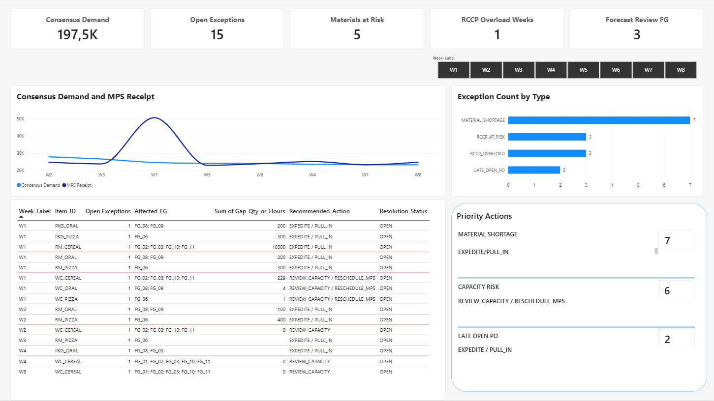
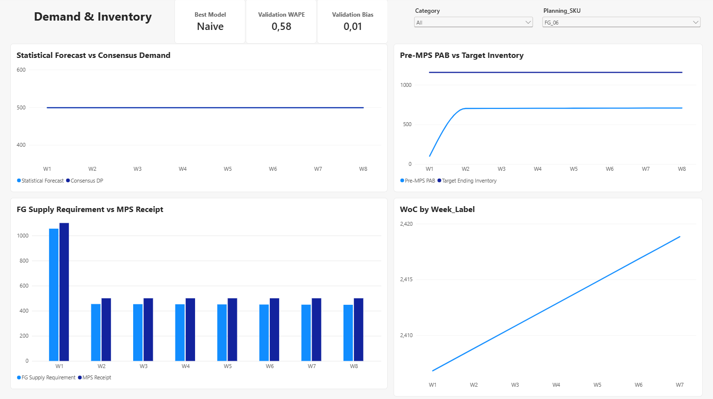
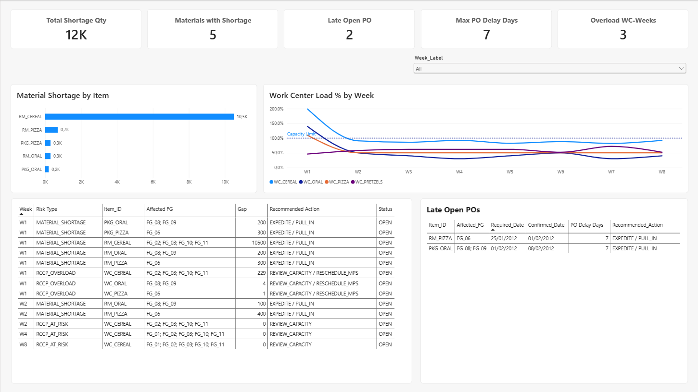

### 1. Statistical Demand Forecasting (Dự báo nhu cầu)
* **Scope (Phạm vi):** Evaluated historical point-of-sale (POS) demand across 47 SKUs and systematically selected **12 core Finished Goods (FGs)** for production planning.
* **Logic (Cơ chế):** Benchmarked multiple time-series algorithms (*Naive, Seasonal Naive, Moving Averages, Simple Exponential Smoothing*) in Python. Automatically identified the **Best Model** per SKU by minimizing Weighted Absolute Percentage Error (WAPE) and ensuring unbiased results (Bias).
  * *Layman's terms:* Instead of guessing, we let Python test 5 different math formulas on past sales data and automatically pick the most accurate formula for each product.

### 2. Operational Planning Engine in Excel (Cỗ máy hoạch định)
* **Inventory Policy (Chính sách kho):** Built dynamic **Safety Stock (SS)** and **Target Ending Inventory (TEI)** formulas (Z \cdot \sigma \cdot \sqrt{L}) to absorb demand volatility while keeping customer service levels high.
* **Master Production Scheduling (MPS - Kế hoạch sản xuất):** Balanced inventory positions (Pre\text{-}MPS\ PAB) to derive net finished good requirements (FG_{REQ}) and generated candidate production runs rounded by factory lot sizes (Q_{FG}).
* **Capacity & Material Planning (RCCP & MRP - Công suất & Vật tư):** Exploded Bills of Materials (BOM) to calculate Gross Material Requirements (GR), net material shortages (NR), and planned vendor orders (PORl). Simultaneously checked factory labor/machine hours against Maximum Capacity (MC).
* **Actionable Exceptions (Bảng sự cố):** Consolidated multi-node supply chain bottlenecks into a clean **15-row Supply Exception Table** (MATERIAL\_SHORTAGE, RCCP\_OVERLOAD, LATE\_OPEN\_PO) with clear recommended planner actions (EXPEDITE, PULL\_IN, RESCHEDULE).
  * *Layman's terms:* Excel acts as the brain that calculates exactly how many boxes of cereal to bake, how many bags of flour to buy from suppliers, and flags any factory machine overload before it happens.

### 3. Reporting & Decision Layer in Power BI (Hệ thống báo cáo)
* **Architecture (Kiến trúc):** Built a multi-fact **Star Schema** (8 model tables, 8 active 1:* single-direction relationships) linked via shared Time (`Dim_Week`) and Product (`Dim_FG`) dimensions.
* **Separation of Concerns (Ranh giới tính toán):** Power BI purely acts as an interactive visualization layer. **No supply planning algorithms are recalculated in DAX**—ensuring absolute calculation truth from Excel.
  * *Layman's terms:* Power BI acts as the control room dashboard. It reads the clean numbers from Excel and displays them visually so managers can make decisions in seconds without getting lost in spreadsheets.

---

## 📊 Dashboard Overview & Key Visuals

### 🟢 Page 1: Executive Supply Planning
> 🎯 **Audience:** Supply Chain Directors & Executive Leadership  
> ⚡ **Purpose:** Provides a 5-second health check of the total supply plan.

* **Key Business Insights:**
  * **Demand vs. Supply Alignment:** Tracks overall 8-week Consensus Demand (197,499 units) against Master Production Receipts (219,500 units) to confirm overall supply feasibility.
  * **Executive Risk Count:** Flags 15 active open exceptions requiring attention and pinpoints 1 critical week (Week 1) facing factory capacity overloads.
* *Layman's View:* High-level summary showing whether the factory is making enough goods to meet market demand this quarter.

---

### 🔵 Page 2: Demand & Inventory Trajectory
> 🎯 **Audience:** Demand Planners & Supply Planners  
> ⚡ **Purpose:** Deep-dives into individual product trajectories over the 8-week planning horizon.

* **Key Business Insights:**
  * **Forecast Discipline:** Compares Statistical Forecast vs Consensus Demand (DP) to ensure planners adhere to baseline data.
  * **Inventory Protection:** Visualizes natural inventory depletion (Pre\text{-}MPS\ PAB) dropping below target safety cushions (TEI) to justify why production runs were triggered.
  * **Lot-Sizing Impact:** Explains the gap between raw net requirement (FG_{REQ}) and actual batch production (MPS) caused by minimum factory lot sizes (Q_{FG}).
  * **Metric Integrity:** Uses strict `HASONEVALUE` DAX logic to prevent invalid aggregations of accuracy metrics (WAPE and Bias).
* *Layman's View:* A detailed flight chart for a single product (e.g., Pizza or Cereal) showing its weekly stock levels, sales forecast, and exact baking batch sizes.

---

### 🔴 Page 3: Supply Risk & Exception Management
> 🎯 **Audience:** Operations Managers & Procurement Team  
> ⚡ **Purpose:** Pinpoints operational bottlenecks and outlines immediate mitigation actions.

* **Key Business Insights:**
  * **Metric Integrity Principle:** Strictly keeps physical risk units separate—never summing mismatched metrics (units, days, hours, and percentages) into a meaningless "risk score".
  * **Material Shortages:** Identifies 12,000 units of raw material shortages across 5 items (dominated by 10,500 units of `RM_CEREAL` at Week 1).
  * **Vendor Delay:** Highlights 2 late open purchase orders with a maximum vendor delay of 7 days (`RM_PIZZA` and `PKG_ORAL`).
  * **Machine Bottlenecks:** Tracks 3 overloaded Work Center-Weeks, led by Cereal Work Center (`WC_CEREAL`) spiking at 199.6\% load (229 hours over capacity).
* *Layman's View:* An emergency room dashboard that tells buyers and factory managers exactly what ingredients are missing, which machine is jamming, and what action to take today.

---

## 🔍 Data Reconciliation & Metric Integrity (Verification & Validation)

To guarantee 100% data fidelity between Excel and Power BI, a rigorous **5-Point Reconciliation Gate** was executed and passed:

| # | Checkpoint Metric | Excel Source (Truth) | Power BI Dashboard | Status | Business Meaning (Layman's terms) |
| :-: | :--- | :---: | :---: | :---: | :--- |
| **1** | **Total 8-Week Demand** | 197,499 units | 197,499 units | **PASS** | Total customer sales volume across all products matches perfectly. |
| **2** | **FG_01 Week 1 Ending Stock (PAB)** | 3,816 units | 3,816 units | **PASS** | Warehouse stock balance calculation for product FG_01 matches exactly. |
| **3** | **RM_PIZZA Week 1 Material Shortage** | 300 units | 300 units | **PASS** | Exact raw material deficit for Pizza ingredient in Week 1 is verified. |
| **4** | **WC_CEREAL Week 1 Machine Load %** | 199.6\% (-229 hrs) | 199.6\% (-229 hrs) | **PASS** | Factory machine overload percentage and missing capacity hours match. |
| **5** | **RM_PIZZA Week 3 Vendor Delivery Delay** | 7 days late | 7 days late | **PASS** | Vendor purchase order confirmation delay is tracked consistently. |

> 🛡️ **Verification vs. Validation Note:**  
> * **Verification (Mathematical Correctness):** Power BI correctly aggregated data using DAX formulas matching Excel output 1:1.  
> * **Validation (Business Meaning):** Metrics are never incorrectly aggregated across time or mismatched units (e.g., Weeks\ of\ Cover is evaluated per single week, never summed across 8 weeks).
